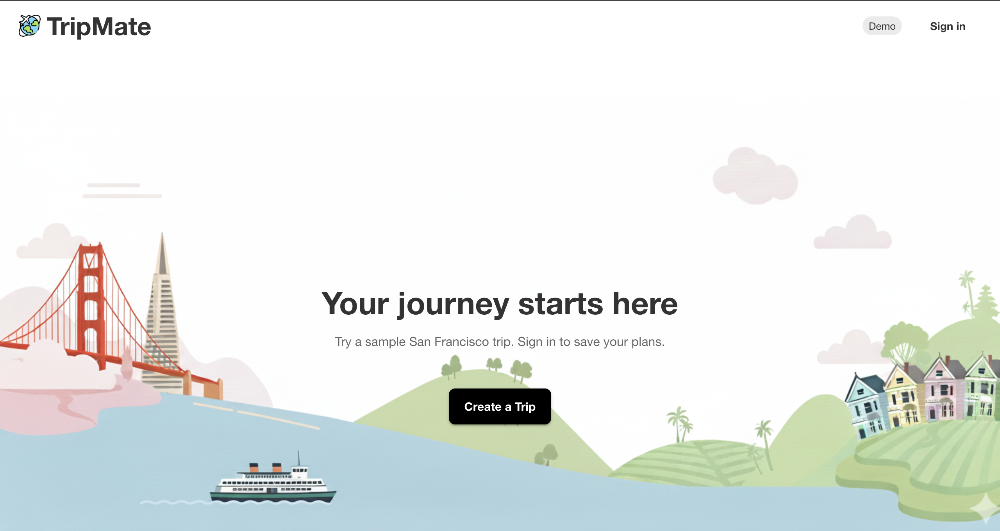
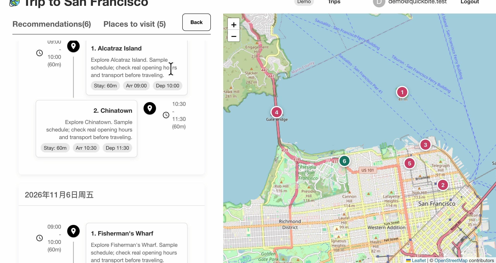
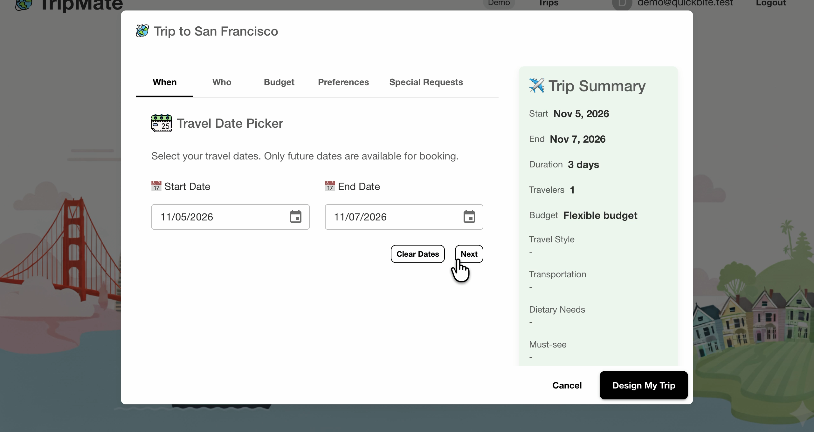
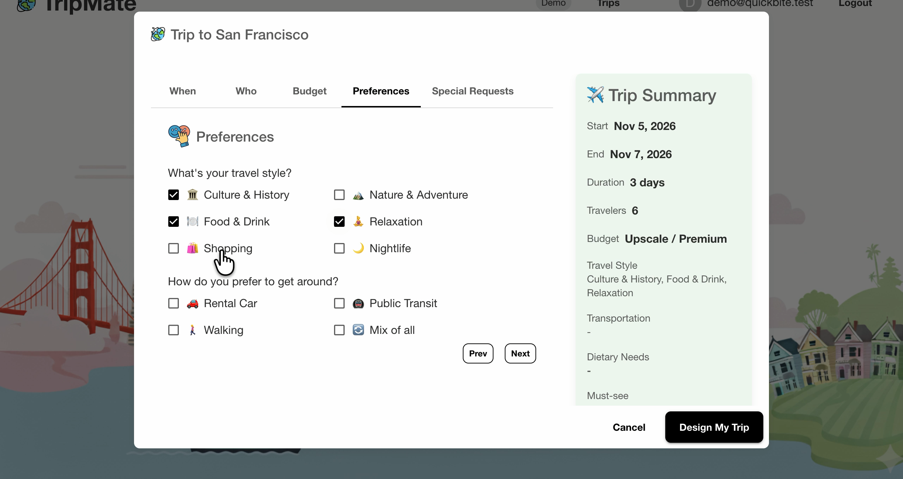

# TripMate

A collaborative AI travel planning project for exploring destinations and organizing itineraries. My role was a frontend contributor. This repository bundles the frontend and an adapted backend for local use.

**React · Material UI · React Router · Maps · Axios · JWT · Spring Boot · PostgreSQL**



## Demo

**[Watch the TripMate demo](https://drive.google.com/file/d/17lyaDc0OAWPabyi8NmhXFo9hxAQFaxwW/view?usp=sharing)**

## Project features

- Search destinations and explore attractions on an interactive map.
- Set travel dates, travelers, budget and preferences.
- Register, sign in and access protected pages using JWT authentication.
- Browse trip plans, pin places of interest and display generated daily itineraries through the team API.



<details>
<summary>View trip setup and preferences</summary>

| Travel dates | Travel preferences |
| --- | --- |
| <a href="docs/images/trip-setup.png"></a> | <a href="docs/images/trip-preferences.png"></a> |

</details>

## Local demo

With Docker Desktop running, copy `.env.example` to `.env`, choose a local database password, then:

```sh
docker compose up --build
```

Open [localhost:8080](http://localhost:8080), register an account and create a trip. `docker compose down` stops the app while retaining the database.

The demo uses the project's sample San Francisco attractions, a key-free OpenStreetMap map and deterministic daily schedules. Accounts, trips, selected places and plans are saved in PostgreSQL. No Google or OpenAI key is needed; sample schedules are not AI-generated.

Without Docker: use Node.js 22, JDK 21 and PostgreSQL, configure the database in `.env`, and run `./scripts/run-demo.sh`. The React build and API are served together on port 8080. Live-mode configuration is described in [backend notes](backend/README.md).

## Tests and build

From `frontend/`:

```sh
npm test -- --watchAll=false --runInBand
npm run build
```

Backend checks: `cd backend && ./gradlew test`. See [verification notes](前端检查说明.zh-CN.md) for the local integration checks and remaining scope.

Backend adapted from [TravelPlannerBackend](https://github.com/Touricks/TravelPlannerBackend) (© 2025 Touricks), under the [MIT License](backend/LICENSE).
